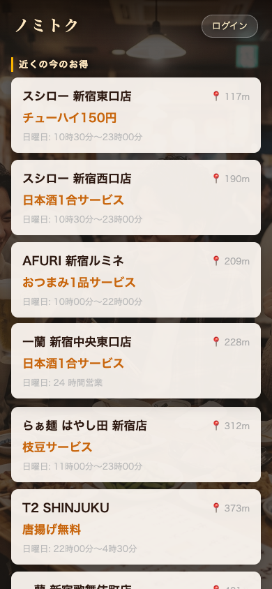

# ノミトク

今いる場所の近くで、お得に飲めるお店を探せる Web アプリです。

**公開中のサイト → https://nomitoku.vercel.app** （スマートフォンでの表示を想定しています）

<p>
  
  
</p>

## できること

- **近くのお店を探す** — 現在地から近い順に、お店とお得情報・今日の営業時間を一覧で表示
- **お店の詳細** — 地図・電話番号・営業時間を1画面で確認
- **会員登録・ログイン** — ログインするとお気に入りのお店を保存できる

お店の情報は Google Places API から取得しています。お得情報（「生ビール半額」など）は、実際のお店の情報ではなくデモ用の仮データです。

## 使った技術

| 部分 | 技術 |
| --- | --- |
| 画面 | React 19、Vite、React Router、Framer Motion |
| API | Python（FastAPI、SQLAlchemy） |
| ログイン | JWT（パスワードは bcrypt でハッシュ化） |
| 外部データ | Google Places API（周辺のお店の検索） |
| 公開 | 画面は Vercel、API は Render |

## 構成

- `frontend-react/` — 画面（`src/pages/` に各ページ）
- `api/` — API（`routers/` に URL ごとの処理、`cruds/` にデータベース操作、`extra_modules/auth/` にログイン、`hotpepper.py`・`google_places.py` に外部 API とのやり取り）
- `init.sql` — テーブル定義

API には次の環境変数を設定します。

```
DATABASE_URL=...           # データベースの接続先
GOOGLE_PLACES_API_KEY=...  # お店の検索に使う
SECRET_KEY=...             # ログイントークンの署名鍵（長いランダムな文字列）
```

画面側は `VITE_API_HOST` に API の URL を設定します（未設定なら `http://localhost:8000`）。
